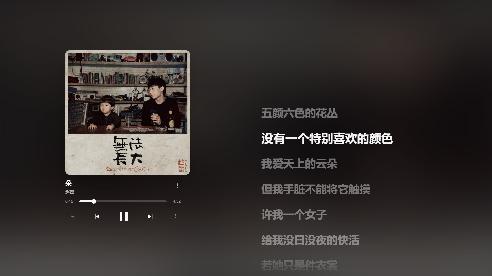
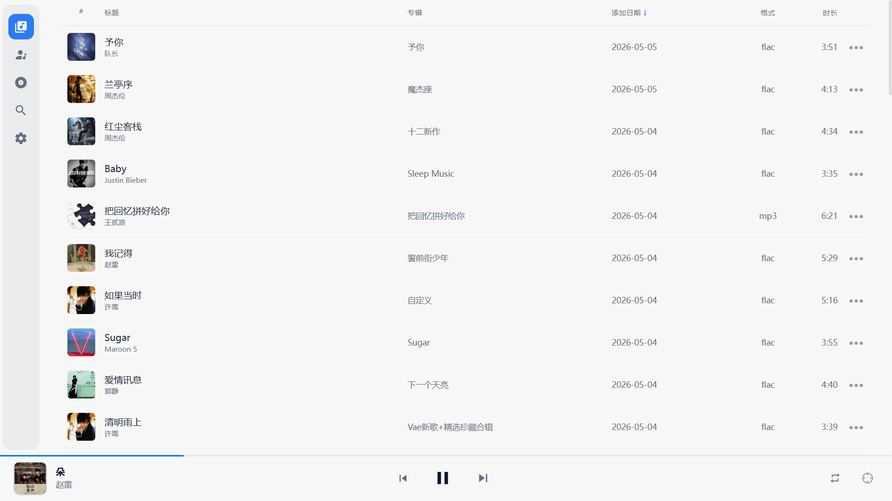
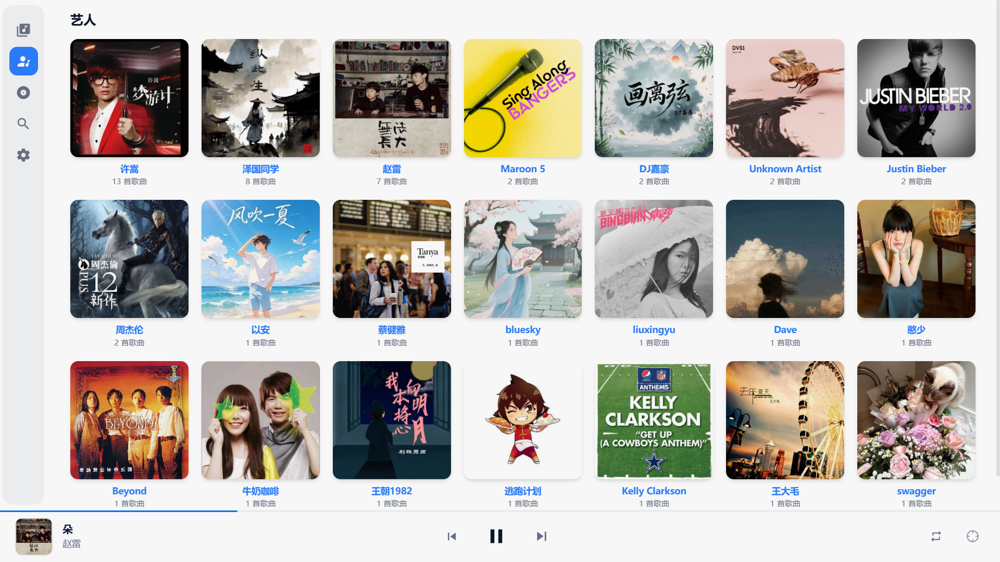
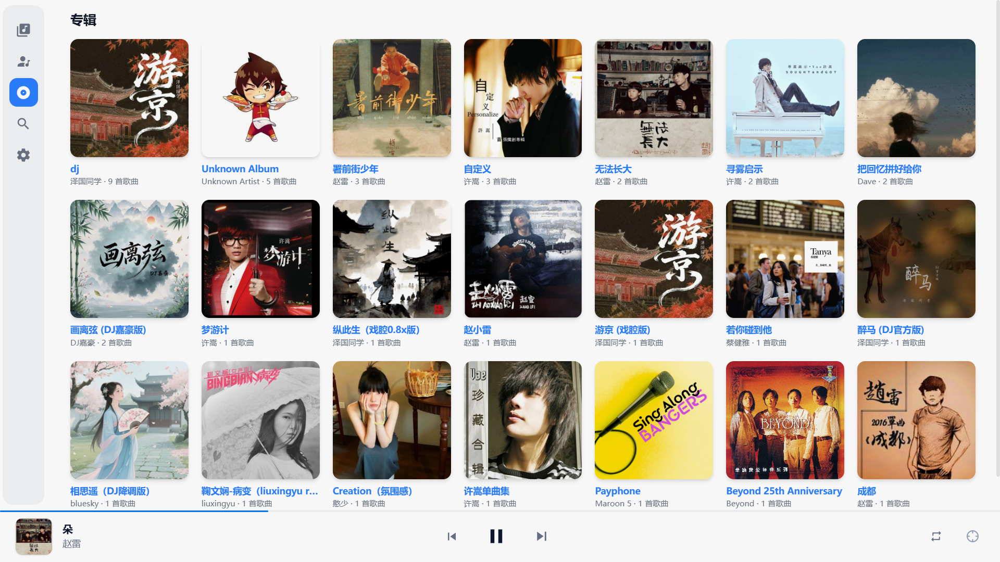
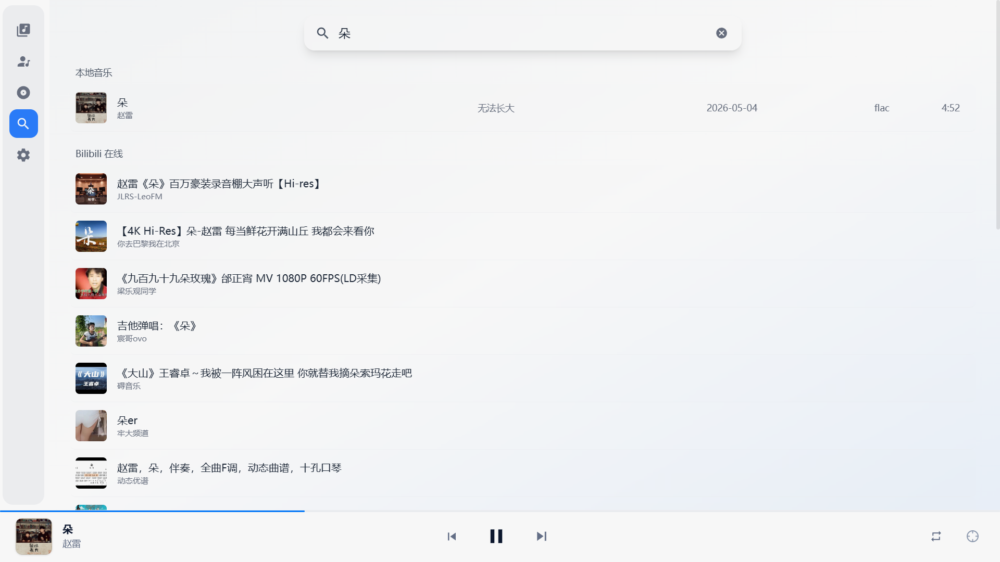
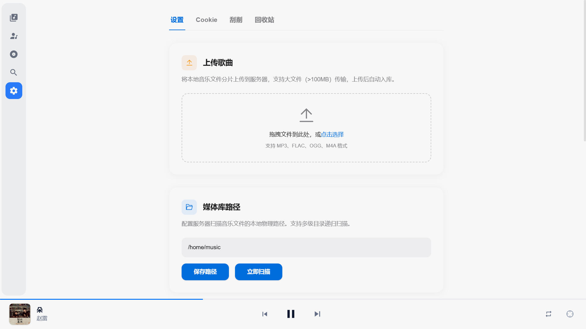
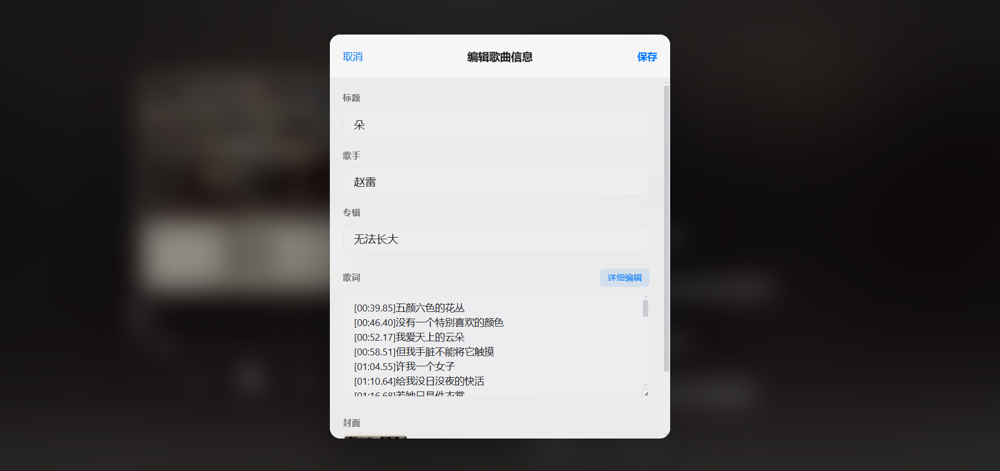
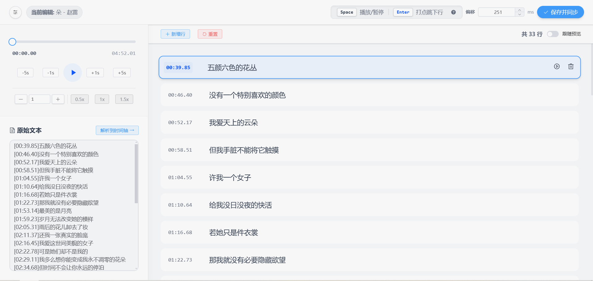
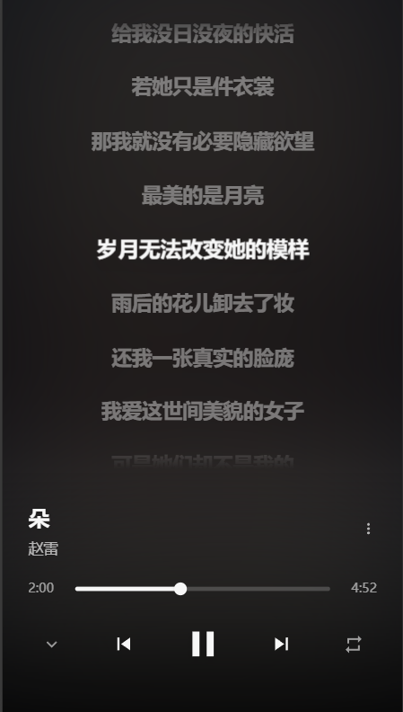
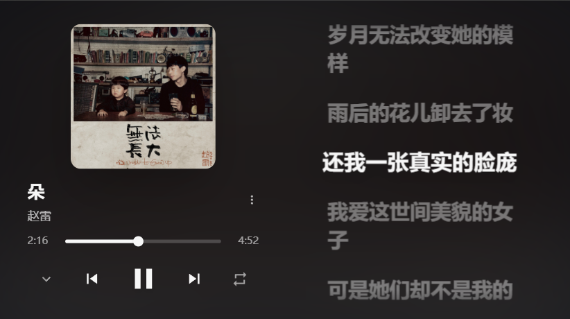

# NasMusic

基于 Django + Vue 3 + Gemini 构建的现代化本地音乐库管理系统。支持音乐扫描入库、多歌手智能拆分、流媒体播放、封面歌词刮削、分片上传、回收站、音乐信息编辑、LRC 歌词时间轴打点、多设备同步播放（派对模式）等功能，提供完整的 RESTful API，可配合 Nginx 部署为高效流媒体服务。

除网页端外，另有一个**纯原生 Android TV 客户端**，专为 10 英尺观看距离和遥控器操作设计。

---

## 项目截图

<p align="center">
  
  
  <br />
  
  
  <br />
  
  
  <br />
  
  
  <br />
  
  
</p>

---

## 功能特性

- **音乐扫描入库**：自动扫描本地音乐文件夹，读取音频文件标签（ID3、Vorbis）并提取封面
- **标签同步**：修改歌曲信息后自动同步写入物理音频文件的 ID3/Vorbis 标签
- **回收站功能**：删除的文件自动移入 `.trash` 目录，支持恢复和彻底删除
- **封面/歌词刮削**：支持从网络自动刮削歌曲封面和歌词（单首/批量），含 Bilibili 音源下载
- **音乐信息编辑**：支持在线编辑歌曲标题、歌手、专辑、歌词、封面等信息
- **歌词时间轴打点**：支持键盘快捷键（Space 播放/暂停、Enter 打点跳下行）精确定位歌词时间轴，可视化编辑 LRC 歌词并同步写入音频文件
- **分片上传**：大文件按 1MB 分片上传，支持断点续传
- **多设备同步播放（派对模式）**：家庭内网中多台设备同步播放同一首歌、同一进度，任意设备均可控制播放、暂停、切歌与进度
- **电视端原生播放**：Android TV 客户端支持遥控器焦点导航、媒体键控制、同步歌词显示

---

## 客户端

| 端 | 技术 | 说明 |
|---|---|---|
| Web | Vue 3 + Vite + Tailwind CSS | 手机 / 平板 / 桌面浏览器，响应式布局 |
| Android TV | 纯原生 Java | 直连后端 REST API，不套 WebView |

电视端是独立原生应用，不复用网页版构建产物——网页版改动不影响电视端，反之亦然。

### Android TV 端

**为什么不用 WebView 套壳。** 试过，三个死结：电视的 WebView 是 Chrome 81（Android 9 老 ROM 无法升级），Vite 产物里的 `||=`（需 Chrome 85+）直接白屏、Tailwind 4 的 `@layer` 整块被丢弃；网页布局按手机设计，1080p 电视上字太小、要用方向键模拟鼠标；打包进去的前端是静态快照，NAS 上的网页更新了 App 不跟着变。

所以重写成原生，只依赖 `androidx.recyclerview` + `zxing-core`，播放用 framework 的 `MediaPlayer` + `MediaSession`，图片加载、模糊、圆角全部自绘。APK 约 1.2MB，冷启动快，Android 9 上零依赖冲突。

| 页面 | 内容 |
|---|---|
| 音乐库 | 全部歌曲，按添加时间倒序，确定键播放 |
| 歌手 | 圆形头像网格，进详情看该歌手全部歌曲 |
| 专辑 | 封面网格，进详情看整张专辑，可「播放全部」 |
| 搜索 | 走 `/api/tracks/?search=`，自动弹输入法 |
| 播放页 | 模糊封面背景 + 大封面 + 进度条 + 播放模式切换 + 同步歌词 |
| 迷你条 | 底部常驻，显示当前歌曲与进度，确定键进播放页 |

**遥控器操作**

- 方向键移动焦点，确定键触发，返回键回上级
- 媒体键（播放/暂停、上一首、下一首）双路接管：`MediaSession` 注册 + 前台 `dispatchKeyEvent` 优先消费。后者是必需的——电视预装的 AirScreen 也注册了 MediaSession，会抢走媒体键
- 播放模式三种：顺序 / 随机 / 单曲循环，选择存 `SharedPreferences`，重启保留
- 播放页按 MENU 键可修改后端地址

**构建安装**

```bash
cd nasmusic-tv
./build.sh          # 构建 APK 并安装到电视
./build.sh build    # 只构建，产物在 app/build/outputs/apk/release/
```

需要 JDK 17 与 Android SDK platform 34。`targetSdk` 故意留在 28（这台电视就是 Android 9），侧载自用不上架 Play。

详细实现说明见 [`nasmusic-tv/README.md`](nasmusic-tv/README.md)。

---

## 派对模式（多设备同步播放）

基于 SSE + REST 实现的低延迟多设备同步播放，适合家庭聚会场景：多台手机/电脑同时外放同一首歌，走到哪个房间音乐都不断档，且任意设备都能切歌。

### 工作原理

- **SSE 长连接**（`GET /api/playback/stream/`）：服务端实时广播播放状态（曲目、进度、播放/暂停）与设备名单变化，每 3 秒发送携带服务器时钟的心跳，供各端持续校准时间
- **REST 指令提交**（`POST /api/playback/command/`）：本地操作（播放/暂停/切歌/拖动进度）实时提交到服务端，广播给其他设备
- **进度对齐**：期望进度 = position + (服务器当前时间 - position_at)，偏差小于 80ms 不纠正，80ms~1s 微调播放速率平滑追赶（人耳无感），超过 1s 才 seek 硬拉
- **Leader 机制**：最早上线的设备负责曲目播完后的切歌推进，掉线时服务端即时重选，避免全员停在曲末
- **鉴权**：播放与接收同步**无需令牌**；控制类操作（提交指令）需要访问令牌

### 使用方法

1. 各设备打开网页（需在同一路由器网络下）
2. 进入「设置」→「多设备同步播放」，打开开关
3. 任意一台设备点歌，其他设备自动同步跟随
4. 若浏览器拦截了自动播放，点击页面上的「加入同步播放」按钮即可（一次性手势）

### 部署要求（WSGI 必须单进程）

同步会话状态与 SSE 连接注册表保存在**单个进程的内存**中。若以多进程部署（如宝塔 Python 项目、Gunicorn、uWSGI），各进程会各持一份独立状态，指令与 SSE 广播被负载均衡分散到不同进程，出现「点击播放偶尔无响应、需多次点击才生效、在线设备数显示 0」等问题。因此：

- **进程数必须为 1**（硬性要求）
- **线程数建议取 CPU 逻辑核心数的 2~4 倍**（如四核四线程 → 8~16 线程）。SSE 长连接为 I/O 等待型负载，每条连接占用一个线程但几乎不消耗 CPU，因此线程数远多于核心数既安全也必要
- 代码层面 SSE 连接数上限为 16（`backend/playback/hub.py` 中的 `MAX_CLIENTS`），如需支持更多设备，需将其与线程数一同上调
- 播放负载为 I/O 密集型，单进程多线程对多核 CPU 的性能几乎无影响；若未来设备规模超过十几台，建议迁移 ASGI（Daphne/Uvicorn）以获得异步 SSE 能力

> **Nginx 必须为 `/api/` 关闭缓冲**，否则 SSE 事件会被积压，同步延迟数秒甚至完全不推送。配置见下方 `proxy_buffering off` 与 `proxy_read_timeout` 两行。

---

## 项目结构

```
NasMusic/
├── backend/                 # Django 后端
│   ├── NasMusic/            # 项目配置（settings、urls、wsgi）
│   ├── library/             # 音乐库核心：模型、序列化、标签读写、上传、回收站
│   ├── scanner/             # 音乐扫描入库（多歌手拆分、封面提取）
│   ├── stream/              # 音频流媒体服务（Range 支持、X-Accel-Redirect）
│   ├── scraper/             # 封面/歌词刮削（含 Bilibili 音源）
│   ├── playback/            # 派对模式：SSE 广播中心 hub.py + 指令接口
│   ├── media/               # 运行时生成的封面等媒体文件
│   ├── manage.py
│   └── requirements.txt
├── frontned/                # Vue 3 前端（目录名拼写就是 frontned）
│   ├── src/
│   │   ├── views/           # 页面：音乐库、歌手、专辑、搜索、设置、歌词打点
│   │   ├── components/      # 组件：播放详情、列表、刮削面板、弹窗
│   │   ├── stores/          # Pinia：播放器状态
│   │   ├── api/             # 后端接口封装
│   │   └── style.css        # Tailwind 入口 + 低版本内核兼容层
│   ├── public/
│   └── vite.config.ts
├── nasmusic-tv/             # Android TV 原生客户端（Java + Gradle）
├── docker/                  # Docker 部署方案（开发中）
├── screenshot/              # 项目截图
├── 接口.txt                 # 后端 REST API 文档
└── README.md
```

---

## 快速开始

### 后端

```bash
cd backend

# 1. 创建虚拟环境
python -m venv .venv
.venv\Scripts\activate        # Windows
# source .venv/bin/activate   # Linux / macOS

# 2. 安装依赖
pip install -r requirements.txt

# 3. 数据库迁移
python manage.py makemigrations
python manage.py migrate

# 4. 创建超级用户
python manage.py createsuperuser

# 5. 启动服务
python manage.py runserver
```

### 前端

```bash
cd frontned
npm install
npm run dev      # 开发服务器 http://localhost:5173
npm run build    # 生产构建，产物在 frontned/dist/
```

开发服务器已把 `/api` 和 `/stream` 代理到 `127.0.0.1:8000`，本地联调不用改后端配置。构建产物丢到 Nginx 静态目录即可。

### Android TV

见上方 [Android TV 端](#android-tv-端) 章节。

### 扫描音乐库

在设置页面填入音乐库路径，点击扫描按钮即可开始扫描。

---

## 浏览器兼容性

前端构建产物目标为 **Chromium 99+**（覆盖 Android 平板上的 X 浏览器等国产内核）。

Tailwind CSS v4 默认依赖几个较新的 CSS 能力，`frontned/src/style.css` 里做了针对性降级，**改动前端样式时请留意**：

| 特性 | 默认要求 | 降级方式 |
|---|---|---|
| `oklch()` 调色板 | Chromium 111+ | `@theme` 块用 sRGB hex 覆盖实际用到的 23 个色阶 |
| `color-mix()` 透明度色 | Chromium 111+ | Tailwind 已生成 8 位 hex 兜底，无需处理 |
| `filter: var(--tw-x,)` | 空 fallback 语法 | 用原生 `filter` / `backdrop-filter` 重写 blur、drop-shadow |
| `scale-125` 独立属性 | Chromium 104+ | 改用 `transform: scale()` |

> **新增颜色时必须同步更新 `@theme`**。直接使用 Tailwind 默认调色板（例如 `bg-emerald-500`）会重新引入 `oklch()`，老内核上该颜色整条失效变成透明。

---

## Nginx 部署配置

生产环境推荐 Nginx 反向代理，配合 Django 的 X-Accel-Redirect 实现高效音频流媒体。

```nginx
server {
    listen 80;
    server_name 10.0.0.8;

    # 前端产物目录，下面所有静态 location 都继承这个 root
    root /www/wwwroot/frontned;

    # 分片上传单片 1MB，multipart 还有额外开销，留足余量
    client_max_body_size 20m;

    gzip on;
    gzip_min_length 1k;
    gzip_comp_level 5;
    gzip_types text/plain text/css application/javascript application/json image/svg+xml;

    # 1. SPA 前端：未命中一律回落到 index.html
    location / {
        try_files $uri $uri/ /index.html;
    }

    # index.html 不缓存，保证发版后立刻生效
    location = /index.html {
        add_header Cache-Control "no-cache, must-revalidate";
    }

    # 带 hash 的构建产物可以放心长缓存
    location /assets/ {
        add_header Cache-Control "public, max-age=2592000, immutable";
    }

    # 2. API 请求
    location /api/ {
        proxy_pass http://127.0.0.1:8000;
        proxy_set_header Host $host;
        proxy_set_header X-Real-IP $remote_addr;
        proxy_set_header X-Forwarded-For $proxy_add_x_forwarded_for;
        proxy_set_header X-Forwarded-Proto $scheme;

        # SSE 长连接必需：不关缓冲的话派对模式的事件会被 nginx 积压
        proxy_http_version 1.1;
        proxy_set_header Connection "";
        proxy_buffering off;
        proxy_cache off;
        proxy_read_timeout 3600s;
    }

    # 3. Django 后台
    location /admin/ {
        proxy_pass http://127.0.0.1:8000;
        proxy_set_header Host $host;
        proxy_set_header X-Real-IP $remote_addr;
        proxy_set_header X-Forwarded-For $proxy_add_x_forwarded_for;
        proxy_set_header X-Forwarded-Proto $scheme;
    }

    # 4. 不带 api 前缀的音频流
    location /stream/ {
        proxy_pass http://127.0.0.1:8000;
        proxy_set_header Host $host;
        proxy_set_header X-Real-IP $remote_addr;
        proxy_set_header X-Forwarded-For $proxy_add_x_forwarded_for;
        proxy_set_header X-Forwarded-Proto $scheme;
        proxy_http_version 1.1;
        proxy_buffering off;
        proxy_cache off;
    }

    # 5. 后台静态资源与封面图
    location /static/ {
        alias /www/wwwroot/NasMusic/backend/static_root/;   # 对应 settings.STATIC_ROOT
    }
    location /media/ {
        alias /www/wwwroot/NasMusic/backend/media/;         # 对应 settings.MEDIA_ROOT
        expires 7d;
    }

    # 6. 高性能流媒体通道（X-Accel-Redirect）
    location /protected_music/ {
        internal;                     # 外部无法直接访问，只能由后端内部跳转
        alias /home/music/;           # 音乐库真实绝对路径
        sendfile on;
        tcp_nopush on;
        add_header Accept-Ranges bytes;
        add_header Access-Control-Allow-Origin *;
        # 不要在这里写 default_type：交给 mime.types 按扩展名判断，
        # 否则 flac / m4a 会被错标成 audio/mpeg
    }
}
```

### 配置要点

| 项 | 作用 | 漏了会怎样 |
|---|---|---|
| `/api/` 的 `proxy_buffering off` | 关闭响应缓冲 | SSE 事件被积压，派对模式不同步 |
| `proxy_http_version 1.1` + `Connection ""` | 启用长连接 | SSE 走 HTTP/1.0，连接反复重建 |
| `client_max_body_size 20m` | 放宽请求体上限 | 默认 1MB，分片上传直接 413 |
| `/static/`、`/media/` 的 alias | 指向 `settings.py` 的 `STATIC_ROOT`、`MEDIA_ROOT` | 封面、后台样式全部 404 |
| `/protected_music/` 不设 `default_type` | 按扩展名给 Content-Type | flac、m4a 被标成 `audio/mpeg` |

> `STATIC_ROOT` 与 `MEDIA_ROOT` 都相对 `BASE_DIR`，实际路径取决于后端放在哪。上面的 `/www/wwwroot/NasMusic/backend/` 只是示例。

---


## 技术栈

**后端**

- Django 6.0 + Django REST Framework 3.17
- 数据库：SQLite（默认）/ PostgreSQL
- 音频处理：mutagen
- 图片处理：Pillow
- 刮削：httpx + BeautifulSoup + bilibili-api-python

**前端**

- Vue 3.5 + Vue Router + Pinia
- Vite 8（Rolldown）
- Tailwind CSS 4 + Element Plus
- 构建目标：Chromium 99+

**Android TV**

- 纯原生 Java，无 WebView、无第三方 UI 框架，界面全部自绘
- 依赖仅 RecyclerView + ZXing core（设置页二维码）
- minSdk 26 / targetSdk 28，适配 Android 9 机顶盒
- 遥控器媒体键通过 framework 层 `MediaSession` + `dispatchKeyEvent` 双路接管

---

## API 文档

完整的 REST API 说明见仓库根目录 [`接口.txt`](接口.txt)，包含鉴权方式、各接口的请求/响应格式与参数说明。

---

## 许可证

MIT License
